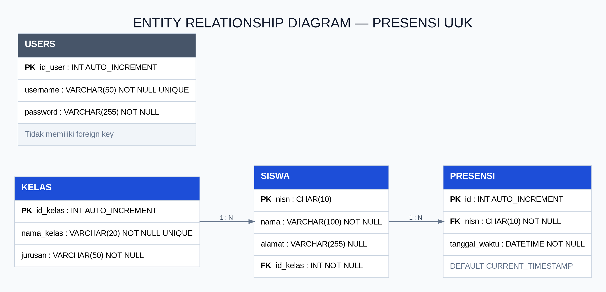
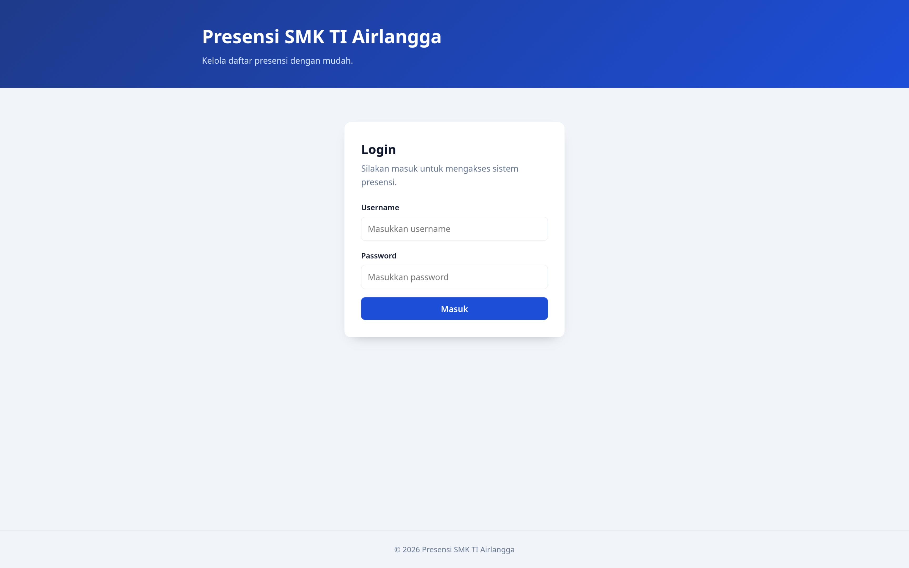
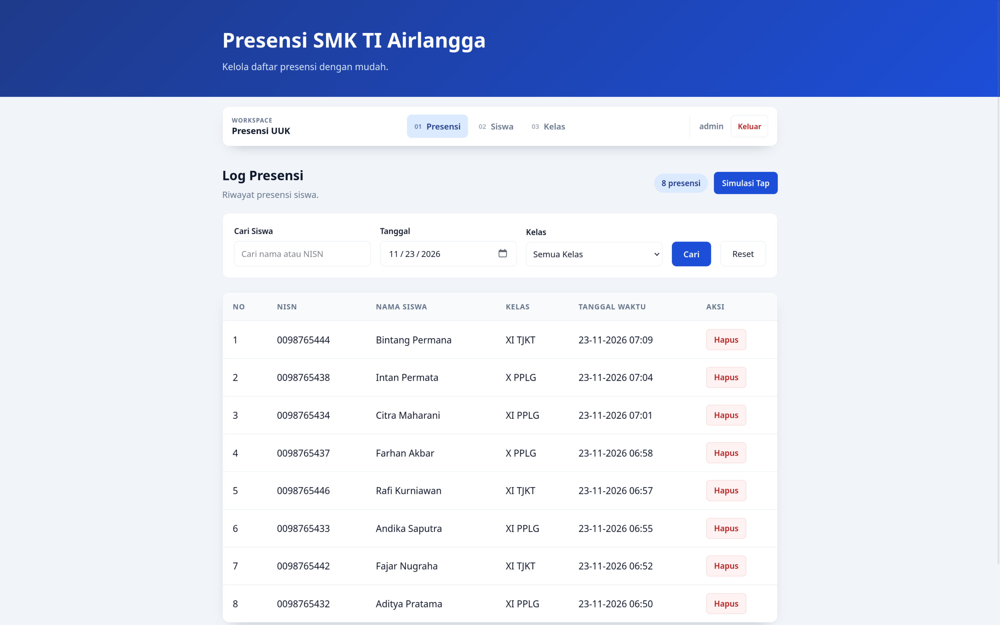
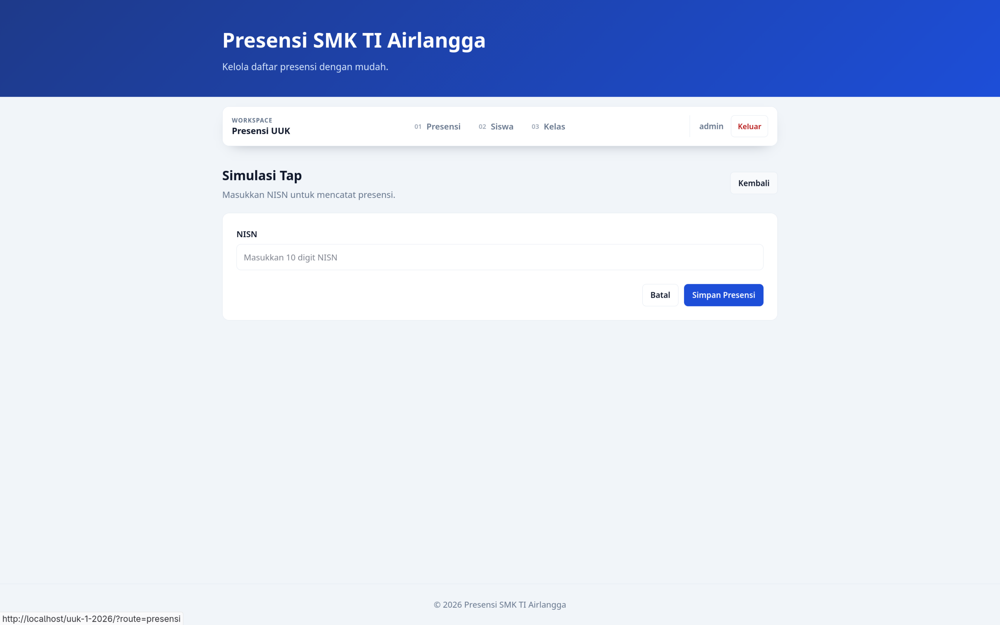
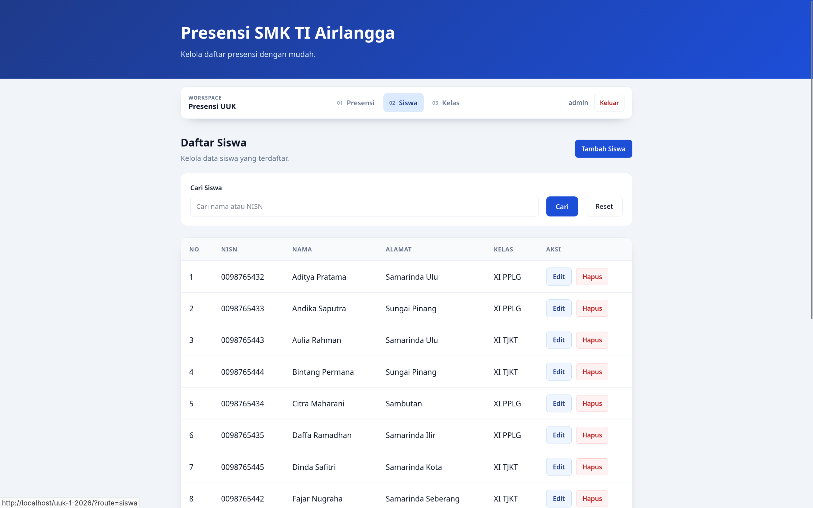
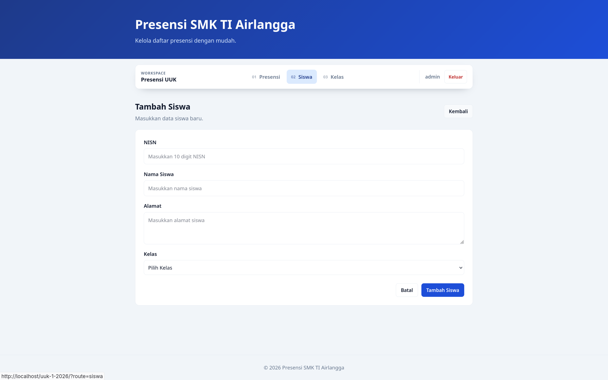
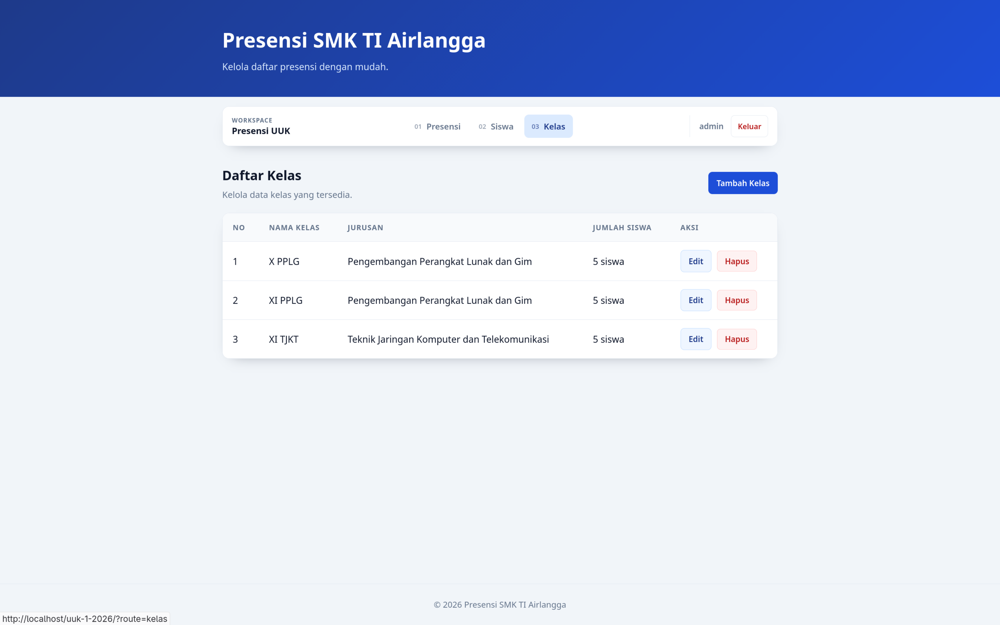
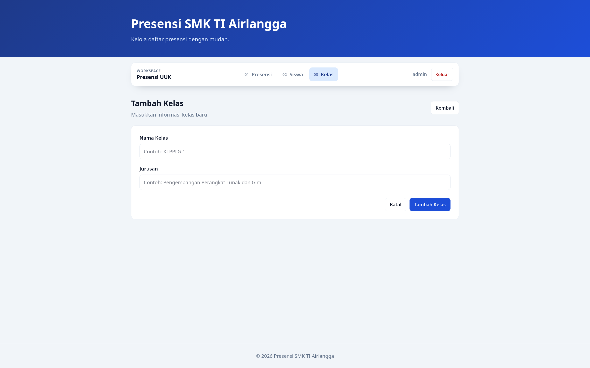

# Presensi UUK — SMK TI Airlangga

Aplikasi web sederhana untuk mengelola data presensi siswa. Aplikasi ini dibuat menggunakan PHP dengan pola arsitektur MVC dan MySQL sebagai database.

## Deskripsi Aplikasi

Presensi UUK membantu admin sekolah mengelola data kelas, data siswa, dan riwayat kehadiran siswa melalui satu halaman web.

### Fitur

- Login dan logout admin.
- Melihat daftar presensi siswa.
- Memfilter presensi berdasarkan tanggal dan kelas.
- Mencari presensi berdasarkan nama atau NISN siswa.
- Menambahkan catatan presensi melalui fitur **Simulasi Tap** dengan memasukkan NISN.
- Menghapus catatan presensi.
- Mengelola data siswa: tambah, lihat, edit, hapus, dan pencarian berdasarkan nama atau NISN.
- Mengelola data kelas: tambah, lihat, edit, hapus, dan melihat jumlah siswa.
- Validasi input serta relasi foreign key pada database.

## Teknologi

- PHP 7.4+ (PHP 8.x direkomendasikan)
- MySQL atau MariaDB
- PDO untuk koneksi dan query database
- HTML dan CSS
- Arsitektur MVC (Model–View–Controller)

Aplikasi tidak membutuhkan Composer atau NPM.

## Struktur Folder

```text
presensi_uuk/
├── assets/
│   └── css/
│       └── style.css
├── config/
│   └── connection.php
├── controllers/
│   ├── AuthController.php
│   ├── KelasController.php
│   ├── PresensiController.php
│   └── SiswaController.php
├── models/
│   ├── BaseModel.php
│   ├── Kelas.php
│   ├── Presensi.php
│   ├── Siswa.php
│   └── User.php
├── views/
│   ├── auth/
│   ├── kelas/
│   ├── layouts/
│   ├── presensi/
│   └── siswa/
├── index.php
├── schema.sql
└── README.md
```

## Cara Instalasi

### 1. Persiapkan lingkungan

Pastikan sudah tersedia:

- PHP 7.4 atau lebih baru.
- MySQL/MariaDB.
- Apache atau web server lokal.
- Ekstensi PHP `PDO` dan `pdo_mysql` aktif.

Laragon atau XAMPP dapat digunakan untuk menjalankan aplikasi secara lokal.

### 2. Letakkan folder proyek

Salin folder `presensi_uuk` ke folder web server lokal.

Contoh lokasi Laragon:

```text
C:\laragon\www\presensi_uuk
```

Contoh lokasi XAMPP:

```text
C:\xampp\htdocs\presensi_uuk
```

### 3. Jalankan Apache dan MySQL

Buka Laragon atau XAMPP, kemudian jalankan layanan Apache dan MySQL.

### 4. Buat database

1. Buka phpMyAdmin melalui `http://localhost/phpmyadmin`.
2. Pilih menu **Import**.
3. Pilih file `schema.sql` dari folder proyek.
4. Klik **Import** atau **Go**.

File `schema.sql` akan membuat database `presensi_uuk` beserta tabel berikut:

- `users`
- `kelas`
- `siswa`
- `presensi`

### 5. Periksa konfigurasi database

Buka `config/connection.php`. Sesuaikan nilai koneksi dengan konfigurasi MySQL di komputer masing-masing.

```php
private $host = 'localhost';
private $username = 'root';
private $password = '';
private $database = 'presensi_uuk';
```

Konfigurasi di atas mengikuti pengaturan default Laragon yang umum digunakan. Ubah username atau password apabila MySQL milikmu menggunakan konfigurasi berbeda.

### 6. (Opsional) Masukkan data contoh

Untuk mengisi aplikasi dengan data kelas, siswa, dan riwayat presensi contoh, impor file `docs/demo-data.sql` melalui menu **Import** di phpMyAdmin. Jalankan sekali setelah `schema.sql` dan sebelum menggunakan aplikasi. File ini mengasumsikan tabel `kelas`, `siswa`, dan `presensi` masih kosong.

### 7. Buat akun demo

Setelah database dibuat, jalankan SQL berikut melalui tab **SQL** di phpMyAdmin:

```sql
INSERT INTO users (username, password)
VALUES (
    'admin',
    '$2y$12$kBfUHTNaP3Ai4IOfkudDQOGQWeygTv.GF8sZGpScaoI8UmbN14m9.'
);
```

Password disimpan dalam bentuk hash yang dibuat dengan `password_hash()` PHP, bukan sebagai teks biasa.

**Akun demo:**

| Username | Password |
|---|---|
| `admin` | `admin123` |

Untuk membuat hash baru secara manual, jalankan perintah berikut dari terminal yang memiliki PHP:

```bash
php -r "echo password_hash('admin123', PASSWORD_DEFAULT), PHP_EOL;"
```

Setiap proses pembuatan hash dapat menghasilkan teks hash yang berbeda karena penggunaan salt. Gunakan hash yang dihasilkan untuk mengganti nilai kolom `password` pada SQL akun demo.

### 8. Buka aplikasi

Akses alamat berikut melalui browser:

```text
http://localhost/presensi_uuk
```

Halaman login akan ditampilkan. Masuk menggunakan akun demo pada bagian sebelumnya.

## Entity Relationship Diagram (ERD)

ERD berikut dibuat berdasarkan struktur tabel pada `schema.sql`.



### Relasi tabel

- **kelas — siswa:** satu kelas dapat memiliki banyak siswa. Relasi menggunakan `siswa.id_kelas` sebagai foreign key.
- **siswa — presensi:** satu siswa dapat memiliki banyak catatan presensi. Relasi menggunakan `presensi.nisn` sebagai foreign key.
- **users:** menyimpan akun untuk login. Pada struktur database saat ini, tabel `users` tidak memiliki relasi foreign key ke tabel lainnya.

## Tangkapan Layar Aplikasi

Tangkapan layar berikut diambil dari template halaman aplikasi dengan data contoh untuk dokumentasi tampilan. Data pada gambar merupakan data preview, bukan hasil pengambilan langsung dari database yang sedang berjalan.

### 1. Halaman Login



### 2. Halaman Log Presensi



### 3. Halaman Simulasi Tap



### 4. Halaman Daftar Siswa



### 5. Form Tambah Siswa



### 6. Halaman Daftar Kelas



### 7. Form Tambah Kelas



## Tabel Hasil Pengujian

Tabel berikut merupakan daftar skenario pengujian manual yang dapat digunakan untuk memeriksa fungsi aplikasi. Pemeriksaan sintaks PHP sudah dijalankan untuk seluruh file PHP dan tidak ditemukan kesalahan sintaks. Pengujian fungsi yang memerlukan koneksi MySQL belum dijalankan secara langsung pada lingkungan dokumentasi ini.

| No. | Skenario Pengujian | Hasil yang Diharapkan | Hasil Pengujian |
|---:|---|---|---|
| 1 | Memeriksa sintaks seluruh file PHP | Tidak ada kesalahan sintaks PHP | **Lulus** (`php -l`) |
| 2 | Login menggunakan akun demo yang benar | Pengguna diarahkan ke halaman Log Presensi | **Lulus** |
| 3 | Login dengan password yang salah | Pesan `Username atau password salah.` ditampilkan | **Lulus** |
| 4 | Membuka halaman Daftar Siswa | Data siswa ditampilkan dalam tabel | **Lulus** |
| 5 | Mencari siswa berdasarkan nama atau NISN | Data yang sesuai dengan kata kunci ditampilkan | **Lulus** |
| 6 | Menambah dan mengubah data siswa | Data tersimpan atau diperbarui sesuai input | **Lulus** |
| 7 | Menghapus siswa yang memiliki riwayat presensi | Penghapusan ditolak karena terikat foreign key | **Lulus** |
| 8 | Menambah, mengubah, dan menghapus kelas | Data kelas berubah sesuai operasi yang dipilih | **Lulus** |
| 9 | Menghapus kelas yang masih memiliki siswa | Penghapusan ditolak dan pesan informasi ditampilkan | **Lulus** |
| 10 | Memfilter presensi berdasarkan tanggal dan kelas | Hanya catatan yang sesuai filter ditampilkan | **Lulus** |
| 11 | Mencari catatan presensi berdasarkan nama atau NISN | Catatan yang sesuai dengan kata kunci ditampilkan | **Lulus** |
| 12 | Simulasi Tap dengan NISN yang terdaftar | Catatan baru masuk ke tabel `presensi` dengan waktu otomatis | **Lulus** |
| 13 | Simulasi Tap dengan NISN yang tidak terdaftar | Pesan bahwa NISN tidak terdaftar ditampilkan | **Lulus** |
| 14 | Simulasi Tap dengan NISN yang bukan 10 digit angka | Pesan validasi format NISN ditampilkan | **Lulus** |
| 15 | Menghapus catatan presensi | Catatan presensi terhapus dari tabel | **Lulus** |

## Catatan

- NISN harus terdiri dari 10 digit angka.
- Setiap catatan presensi terhubung dengan NISN yang sudah terdaftar pada tabel `siswa`.
- Waktu presensi diisi otomatis oleh database melalui `DEFAULT CURRENT_TIMESTAMP` apabila tidak diberikan secara manual.
- Untuk penggunaan sebenarnya, ganti kredensial database sesuai lingkungan server dan jangan gunakan password akun demo.